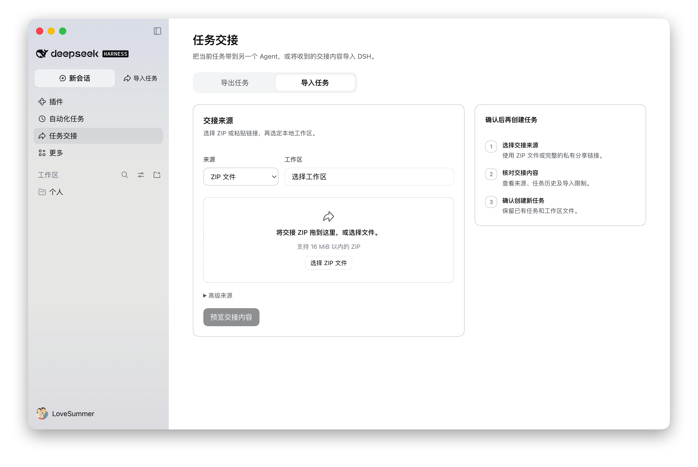

<h1 align="center">Agent Handoff</h1>
<p align="center"><strong>Share a task. Continue it in your coding agent.</strong></p>
<p align="center">Codex · Claude Code · DeepSeek Harness</p>
<p align="center">
  <a href="#install">Install</a> · <a href="#use">Use</a> · <a href="docs/usage.md">Documentation</a> · <a href="README.zh-CN.md">简体中文</a>
</p>
<p align="center">
  <a href="https://github.com/DavidDingXu/agent-handoff/actions/workflows/ci.yml"></a>
  <a href="https://github.com/DavidDingXu/agent-handoff/actions/workflows/codeql.yml"></a>
  <a href="LICENSE"></a>
</p>

Move conversation and tool evidence to another person, machine or coding agent.
Share a **ZIP file** or **end-to-end encrypted link**; the receiver previews it,
then opens a **new native task**. Existing tasks stay intact.

## Install

### Codex / Claude Code

```sh
# Codex
codex plugin marketplace add https://github.com/DavidDingXu/agent-handoff
codex plugin add agent-handoff@agent-handoff

# Claude Code
claude plugin marketplace add https://github.com/DavidDingXu/agent-handoff
claude plugin install agent-handoff@agent-handoff
```

Install or update to **0.5.1** on both sides, then restart the agent.

### DeepSeek Harness

1. Open **Plugins → Add plugin** in DSH.
2. Enter `dsh-agent-handoff`, select the **official npm registry**, then **Install** and enable it.
3. Open **Task handoff** in the sidebar. Restart DSH if the entry does not appear.

[npm package](https://www.npmjs.com/package/dsh-agent-handoff) ·
[Offline install, Web profiles & source builds](plugins/dsh/README.md).

## Use

| Host | Share | Receive |
| --- | --- | --- |
| Codex / Claude Code | Say “share the current task” | Say “import <file/link>” |
| DSH | **Task handoff → Export task** | **Task handoff → Import task** |

- **Export from DSH:** search for and select the task, choose ZIP or encrypted link, then **Create share**. Send the file or complete link to the receiver.
- **Import into DSH:** choose a ZIP or paste a share link, select a local workspace, then **Preview handoff**. Review and confirm, then **Open task** to continue.

Imports create a new task. Repeated imports return the previously imported task.



## What travels

- **Conversation and tool evidence:** all nine transfer directions among the
  three hosts are tested. Same-host native history is preserved where supported.
- **Privacy:** links use local AES-256-GCM encryption; secret findings require
  explicit consent. ZIP files contain plaintext and should be kept private.
- **DSH boundary:** reviewed passive history can restore natively; ordinary logs
  with runtime state require explicit conversation import. Credentials,
  permissions, queued work and full media restoration are excluded.

macOS/Linux x64 and arm64; Windows x64. Exact evidence and limitations:
[compatibility](docs/usage.md#compatibility) · [DSH verification](plugins/dsh/VERIFICATION.md).

## Documentation

[Detailed usage & CLI](docs/usage.md) · [DSH install & configuration](plugins/dsh/README.md) ·
[Own file service](docs/link-service.md) · [Bundle format](docs/bundle-format.md) ·
[Development](CONTRIBUTING.md) · [Roadmap](ROADMAP.md) · [Security](SECURITY.md)

Questions and contributions: [open an issue](https://github.com/DavidDingXu/agent-handoff/issues/new/choose).
Maintained by **DavidDingXu**. [Apache-2.0](LICENSE).
