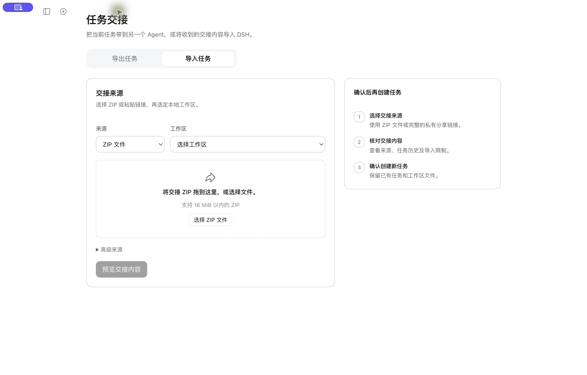

<h1 align="center">Agent Handoff</h1>
<p align="center"><strong>把编码任务交给对方，换台机器、换个智能体接着做。</strong></p>
<p align="center">Codex · Claude Code · DeepSeek Harness</p>
<p align="center">
  <a href="#安装">安装</a> · <a href="#使用">使用</a> · <a href="docs/usage.zh-CN.md">详细文档</a> · <a href="README.md">English</a>
</p>
<p align="center">
  <a href="https://github.com/DavidDingXu/agent-handoff/actions/workflows/ci.yml"></a>
  <a href="https://github.com/DavidDingXu/agent-handoff/actions/workflows/codeql.yml"></a>
  <a href="LICENSE"></a>
</p>

将对话和工具记录分享为 **ZIP 文件**或**端到端加密链接**。接收方预览后，在自己的编码
智能体中打开一个**原生新任务**，继续处理。已有任务不会被覆盖。

## 安装

### Codex / Claude Code

```sh
# Codex
codex plugin marketplace add https://github.com/DavidDingXu/agent-handoff
codex plugin add agent-handoff@agent-handoff

# Claude Code
claude plugin marketplace add https://github.com/DavidDingXu/agent-handoff
claude plugin install agent-handoff@agent-handoff
```

重启智能体即可。发送方和接收方都需安装插件。

### DeepSeek Harness · 实验性支持

支持 **DSH 0.2.2-rc.1 / rc.5**、Node **>=24.9.0**。

1. 从 [Releases](https://github.com/DavidDingXu/agent-handoff/releases) 下载 `dsh-agent-handoff-0.5.0.tgz`。
2. 在 DSH 打开**插件 → 添加插件 → 安装第三方插件**。
3. 填写下载文件的绝对路径，安装后启用。

目前没有可直接安装的 npm 包名。Web profile 命令与源码构建见
[DSH 安装指南](plugins/dsh/README.zh-CN.md)。

## 使用

| 宿主 | 分享 | 接收 |
| --- | --- | --- |
| Codex / Claude Code | 说「分享当前任务」 | 说「导入 <文件/链接>」 |
| DSH | **任务交接 → 导出任务** | **任务交接 → 导入任务** |

发送方选择文件或加密链接；接收方选择本地工作区，核对内容后确认创建新任务。
重复导入同一份内容会返回之前创建的任务。



## 能迁移什么

- **对话与工具记录：** 三个宿主之间的九条交接方向均有测试，支持的同宿主历史原生恢复。
- **隐私：** 链接在本机以 AES-256-GCM 加密，检测到密钥需显式确认；ZIP 含明文，请妥善保管。
- **DSH 边界：** 已审查的被动历史可原生恢复；含运行状态的普通日志需显式选择对话导入。
  不迁移凭据、权限、待执行工作，也不保证完整媒体恢复。

覆盖 macOS/Linux x64、arm64 与 Windows x64。准确范围与依据：
[兼容性](docs/usage.zh-CN.md#兼容范围) · [DSH 验证记录](plugins/dsh/VERIFICATION.md)。

## 详细文档

[使用与 CLI](docs/usage.zh-CN.md) · [DSH 安装与配置](plugins/dsh/README.zh-CN.md) ·
[自己的文件服务](docs/link-service.zh-CN.md) · [捆绑包格式](docs/bundle-format.zh-CN.md) ·
[参与开发](docs/CONTRIBUTING.zh-CN.md) · [路线图](docs/ROADMAP.zh-CN.md) · [安全](docs/SECURITY.zh-CN.md)

问题与建议欢迎[提交 Issue](https://github.com/DavidDingXu/agent-handoff/issues/new/choose)。
作者：**DavidDingXu** · [Apache-2.0](LICENSE)。
