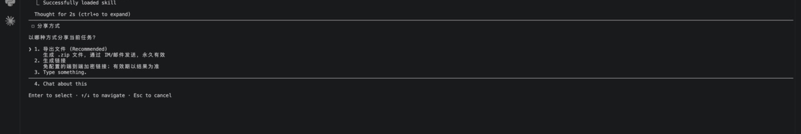

# Usage and compatibility

[简体中文](usage.zh-CN.md) · [Main README](../README.md) · [DSH guide](../plugins/dsh/README.md)

This guide covers the Codex/Claude Skill and local CLI. DSH uses its native plugin interface.

## Local agent switching

Switching reads an already persisted task and creates a new native target task locally. It does
not call the source model, upload conversation, or require remaining source-model quota. A new
continuation turn uses the target model's quota; the imported history still occupies its context.

- **DSH:** choose a task, **Switch agent**, and Codex/Claude Code. The new task is created on
  the machine running DSH. Copy its continue command from the result dialog; closing and
  reopening that dialog reuses the same task. Its project directory is shown separately. A remote browser
  does not launch an app on its own machine. Same-machine switching uses existing code files.
- **Claude Code:** update the plugin and run `/handoff codex`. This immediate local command
  uses the exact session ID without starting a Claude turn. It displays the resume command.
  [Entry and version boundaries](../plugins/claude/README.md).
- **Codex:** add a toolbar Action in project local-environment settings. When no exact current
  ID is supplied by the host, the integrated terminal asks you to choose a task.
  [Action setup](../entries/codex/README.md).

Install the matching standalone CLI binary from [Releases](https://github.com/DavidDingXu/agent-handoff/releases/latest)
on PATH, or replace `agent-handoff` below with the plugin core's absolute path. The DSH npm
package does not install a global terminal command.

```sh
agent-handoff switch --source codex --target claude --open
agent-handoff switch --source claude --target codex --thread EXACT_SESSION_ID
agent-handoff tasks --source codex --cwd /path/to/project
```

`--open` resumes history in a terminal without sending a continuation prompt. Omit it to return
the new task and resume command only. `--home` selects the source configuration directory;
`--target-home` selects the target. Without an exact ID, an interactive terminal shows a picker;
noninteractive calls return `selection_required` with candidates. The newest task is never
silently substituted. Each explicit switch creates a new task; ordinary duplicate imports retain
their existing behavior.

## Automatic brief and browser reading

New exports contain the first request, latest request, latest response and up to six recent tool
records, attributed to transcript entry indices. Extraction is deterministic and local, with no
model call or inferred completion claim. Add **Handoff note** in DSH or pass
`share --brief-note "What the receiver should know"`. Notes are limited to 8 KiB and scanned
for sensitive content.

No plugin installation or site deployment is required to read a share. Open a complete encrypted link to decrypt, verify and read the brief, conversation and expandable
tool evidence locally in a browser. Download the ZIP or copy its import command to continue.
The key stays in the URL fragment. Bundle HTML, commands and remote resources never run or
load. If an anonymous storage service blocks browser CORS, import through the CLI/plugin.
Reading never imports a task automatically. Preview and confirm in the plugin to continue;
applying code attachments requires a separate explicit choice.
`brief_path` points to the imported private brief file; full native history is retained separately.

## Optional code changes

Use this to move uncommitted work to another machine or hand a partial change to a collaborator.
Code is off by default; same-machine switching uses existing files. For already pushed commits,
the receiver can usually pull the repository first.

Enable **Include code changes** in DSH to review files, byte counts and the base commit. Eligible
tracked text changes start selected; new files start unchecked. Deselect individual files freely.
Credentials, dependency/build directories, binaries, symlinks and submodules are excluded.
For the CLI, inspect first, then select:

```sh
agent-handoff bridge code-inspect --cwd /path/to/repo
agent-handoff share --source codex --thread EXACT_ID --include-code --code-file tests/new-test.txt
agent-handoff preview task.agent-handoff.zip
agent-handoff import task.agent-handoff.zip --target claude --cwd /path/to/repo --apply-code --execute
```

`--include-code` chooses eligible tracked text changes. Repeat `--code-file` for exact changed/new
files; used alone, it includes only those files. The base is local `HEAD`, with staged and unstaged
differences for the selected paths. It never packs the entire repository. Limits: 256 files, 1 MiB
per file, 8 MiB combined patch/new content. DSH's 16 MiB ZIP upload/download limit remains.
Use Git for larger changes.

Receiving code is opt-in. DSH previews the inventory and new directory; only **Apply code in a
new workspace** creates a separate Git worktree and new task. For CLI imports, `--cwd` is an
existing local repository; optional `--code-directory` chooses the new worktree, otherwise a fresh
sibling directory is generated. The repository must already contain the base commit. No remote
fetch is attempted. Missing bases, conflicts and unsafe paths stop application without changing
the existing workspace. Retained code directories appear in recovery output. A conversation-only
DSH import can be previewed again to explicitly create a task with code later.

These optional entries retain bundle v2. Older clients can read original history but have no new
brief/code recovery UI; update both sides to 0.6.0 for the complete workflow.

## Compatibility

Verified on 2026-11-19 with **Codex CLI 0.167.1** and **Claude Code 2.1.322**:
imported history read/resume/list (including fresh Codex homes), plus completed
continuation turns from Codex, Claude and DSH sources using local model API
fixtures. Codex also rereads the old and new history in a second process.
CI repeats native-client checks against current npm releases; ordinary unit
tests alone do not certify a new client version. DSH evidence is recorded in
[the plugin verification receipt](../plugins/dsh/VERIFICATION.md).

Codex exports support plain and Zstandard-compressed rollouts, including
pagination bases. On a fresh home, Codex creates its own database on first launch.
Cross-agent Codex imports use `model_provider` from the receiver's base
`config.toml`, defaulting to `openai`. Runtime command-line overrides and named
profile files are not inferred. Same-agent Codex resume retains the source
provider ID, which must also be configured on the receiver; provider endpoints
and credentials are not transferred. Continue a Claude import from its target
directory with `claude --resume <session-id>`, or use the returned
`fallback_command` in its indicated `fallback_shell` (`sh` or PowerShell).

These checks cover local coding sessions and text/tool history. They do not
certify the Claude web chat, cloud-only tasks, multi-agent child-session trees,
or full cross-agent image/attachment restoration. Embedded media remains in the
raw source session; account-bound attachment references are not made portable.

## Other install options

**Standalone CLI — macOS/Linux:**

```sh
curl -fsSL https://raw.githubusercontent.com/DavidDingXu/agent-handoff/main/install.sh | sh
```

**Standalone CLI — Windows PowerShell:**

```powershell
irm https://raw.githubusercontent.com/DavidDingXu/agent-handoff/main/install.ps1 | iex
```

Or download an archive from [Releases](https://github.com/DavidDingXu/agent-handoff/releases/latest). Both installers require and verify the published SHA-256 checksum.

**From source (Go 1.26+):**

```sh
git clone https://github.com/DavidDingXu/agent-handoff && cd agent-handoff
make build                    # → bin/agent-handoff
make install                  # → $(go env GOPATH)/bin/agent-handoff
```

## Codex / Claude Code usage

Once the plugin is installed, everything is conversational — your agent drives the bundled agent-handoff skill.

The screenshot below comes from the real agent-handoff Skill running inside
Claude Code. It shows the native file-or-link question rather than a standalone
CLI demonstration.



_Claude Code loads the Skill and asks whether to export a permanent zip or create an encrypted link._

The native choice appears whenever the current agent mode exposes its question
tool. Codex modes without `request_user_input` show the same file-or-link choice
as a concise text question and wait for the reply; they never silently choose a
format or imitate a native numbered form. Successful links are always printed
verbatim in a copyable code block, including the required `#h=` or `#k=`
fragment.

### Share the current task

> You: “share the current task” / 「分享当前任务」

The agent produces `fix-flaky-retry-test.agent-handoff.zip` and shows a card: title, size, 27 messages, 2 images. Send the file over IM/email.

### Share as a link

> You: “create a share link” / 「生成分享链接」

The agent returns an end-to-end encrypted HTTPS link without an account, token, or deployment. The project-operated compatible service (currently the optional Worker implementation) is used first, with a 10-minute default and up to 24 hours via `--ttl`. If it is unavailable, anonymous providers are automatic fallbacks (24 hours by default, configurable up to 7 days; a provider may delete its copy sooner). The decryption capability stays in the URL fragment, so always send the **full link**. Every service is best-effort; use a zip when delivery must be permanent. See [docs/link-service.md](link-service.md).

### Use your own file service

The built-in service needs no configuration. To use an existing domestic object
store, enterprise file platform, or another file service, declare an HTTP
provider in the platform config directory at `agent-handoff/config.json`:

```json
{
  "providers": [{
    "name": "my-service",
    "upload_url": "https://files.example.com/api/upload",
    "upload_type": "multipart",
    "file_field": "file",
    "headers": { "Authorization": "Bearer ${MY_FILE_TOKEN}" },
    "response_type": "json",
    "url_json_pointer": "/data/url"
  }]
}
```

Keep tokens in local environment variables, not in the config or conversation.
agent-handoff still uploads only locally encrypted ciphertext, and the receiver
needs no configuration for that file service. If every configured provider
fails, the CLI returns a local zip and does not silently upload elsewhere. See
[custom providers](link-service.md#custom-providers) for config paths,
fields, and raw/multipart examples.

### Import on the receiving side

Your teammate just tells their agent (Codex or Claude Code, with the plugin installed):

> “import /path/to/fix-flaky-retry-test.agent-handoff.zip” / 「导入 <文件>」
> “import https://share.example.com/s/Wi5x…#k=Qm9…” / 「导入 <链接>」

The agent shows a preview card (title, origin, time range, first/last message), then imports it as a **native new task** at the top of the task list, ready to continue. Imported titles use the `[Handoff] ` prefix so they are easy to distinguish from local tasks. Re-importing the same share returns `duplicate` instead of silently forking.

### Cross-agent

Source and target agents are auto-detected (e.g. importing a codex-exported bundle inside Claude Code) — no manual flags needed. Same-agent → native-fidelity restore with fresh task identity; cross-agent → semantic conversion (visible conversation and tool evidence preserved; model, git branch, timestamps carried over).

Prefer the CLI directly? The Commands section below is what every conversation above runs under the hood.

## Commands

| Command | Purpose |
| --- | --- |
| `share` | Export a thread/session as `.agent-handoff.zip` (or an encrypted link) |
| `preview` | Inspect a bundle (file or URL) without importing |
| `import` | Dry-run or `--execute` an import into a target agent |
| `verify` | Confirm an imported task is queryable in the target agent's state |

Key flags (see `agent-handoff` with no arguments for the full list):

- `share`: `--source codex|claude`, `--thread <id>|current`, `--format zip|link`, `--out FILE`, `--config FILE`, `--ttl SECONDS`, `--include-secrets`
- `import`: `--target codex|claude`, `--cwd DIR`, `--execute`, `--allow-duplicate`, `--home DIR`
- `verify`: `--thread ID`, `--source codex|claude`, `--cwd DIR`

Source/target agents are auto-detected from `CODEX_THREAD_ID` / `CLAUDE_SESSION_ID`-style environment variables, defaulting to codex. Homes resolve from `CODEX_HOME` / `CLAUDE_CONFIG_DIR` or `~/.codex` / `~/.claude`.

Environment: `AGENT_HANDOFF_RESOLVER` (optional static resolver page for relay links); provider credential variables are referenced by the user's own `config.json`.

## How it works

```
sender                                        receiver
──────                                        ────────
~/.codex/sessions/…/rollout.jsonl   ─┐        ┌─> new rollout.jsonl (fresh UUIDv7 id)
~/.codex/state_5.sqlite (threads row)│  zip   │   threads row appended (schema-aware)
        neutral transcript  ←────────┼──────> │   ~/.claude/projects/…/<uuid>.jsonl
        images, manifest, checksums  ─┘  or   │   index entry + ledger record
                                           link (AES-256-GCM, capability in URL fragment)
```

A bundle is a deterministic zip: `manifest.json`, the raw source session, a neutral transcript, agent metadata, images, a secret-scan report, per-file SHA-256 checksums, and an `AGENT_README.md` written for the receiving agent. Full spec: [docs/bundle-format.md](bundle-format.md).

Import is deliberately conservative:

1. **Checksums first** — integrity is verified before anything is written.
2. **Duplicate ledger** — a per-home ledger records every import; re-importing the same share returns `status: duplicate` instead of silently forking.
3. **Append-only writes** — backups land next to the originals; on failure the error is reported verbatim.
4. **Untrusted content stays data** — nothing inside a shared session is ever executed or fetched by agent-handoff itself.

## Security

- Link payloads are AES-256-GCM encrypted client-side; the server stores ciphertext only and cannot decrypt.
- Export is blocked on high-confidence secret findings unless you pass `--include-secrets`.
- Bundle checksums make tampering detectable; `preview` reports `checksum_status`.
- Please report vulnerabilities privately — see [SECURITY.md](../SECURITY.md).

## Development

```sh
make test      # unit + integration (four-quadrant round trips, link crypto)
make lint      # golangci-lint
make build     # bin/agent-handoff
```

With both CLIs installed, run the native compatibility tests with
`AGENT_HANDOFF_NATIVE_TESTS=1 go test ./internal/integration_test -run TestNative -count=1`.
They use temporary homes and a local API fixture, without account credentials or
paid model requests. `CODEX_BIN` and `CLAUDE_BIN` can select specific executables.

CI runs tests with `-race` on Ubuntu/macOS/Windows. Architecture: `internal/bundle` (container format), `internal/{codex,claude}` (agent adapters), `internal/neutral` (cross-agent transcript), `internal/link` (E2E crypto + compatible hosted endpoints and configured providers), `internal/safety` (secret scan), `internal/cli`. Adding another agent also requires native restore, neutral conversion, host detection, and the cross-agent test matrix; see [docs/adding-agent.md](adding-agent.md).

Current follow-up is validating and maintaining the native
[DSH plugin](../plugins/dsh/README.md) against its pinned runtime. OpenCode support, setup diagnostics, and richer
pre-share review are deferred. See the outcome-focused [roadmap](../ROADMAP.md).

Contributions welcome — see [CONTRIBUTING.md](../CONTRIBUTING.md) ([中文](CONTRIBUTING.zh-CN.md)). Apache-2.0 licensed.
