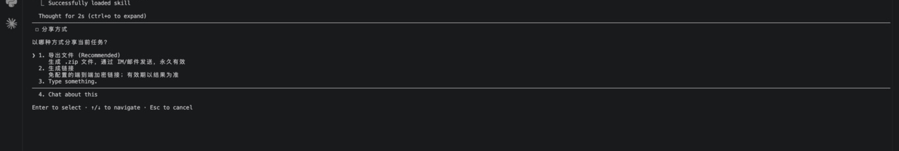

# 使用与兼容性

[English](usage.md) · [主 README](../README.zh-CN.md) · [DSH 指南](../plugins/dsh/README.zh-CN.md)

本指南覆盖 Codex/Claude Skill 与本地 CLI；DSH 使用独立的原生插件界面。

## 兼容范围

2026-11-19 已使用 **Codex CLI 0.167.1** 和 **Claude Code 2.1.322** 验证：
导入后历史读取／恢复／列表发现（含 Codex 全新配置目录），以及来自 Codex、Claude、
DSH 的任务在本地模拟模型 API 上完成新一轮对话。Codex 还会用第二个进程读回新旧
历史。CI 会对 npm 当前版本重复原生客户端检查；普通单元测试通过，不等于已经验证
某个新客户端版本。DSH 证据见[插件验证记录](../plugins/dsh/VERIFICATION.md)。

Codex 支持普通与 Zstandard 压缩的 rollout，包括分页历史基底。全新配置目录的
数据库由 Codex 首次启动时自行初始化。跨智能体导入读取接收端基础 `config.toml`
中的 `model_provider`，默认 `openai`；不会猜测启动参数覆盖或命名 profile 文件。
同端 Codex 恢复保留来源 provider ID，接收端也需要配置同名 provider；交接包不携带
provider 地址或凭据。
Claude 导入后，在目标目录使用 `claude --resume <session-id>`，或在返回的
`fallback_shell`（`sh` 或 PowerShell）中执行 `fallback_command`。

上述验证覆盖本地编码会话和文本／工具历史，不代表支持 Claude 网页聊天、仅存在于
云端的任务、多智能体子会话树，或跨智能体完整图片／附件恢复。内嵌媒体保留在原始
源会话中；绑定账号的附件引用不会自动变成可跨机器访问的文件。

## 其他安装方式

**独立 CLI — macOS/Linux：**

```sh
curl -fsSL https://raw.githubusercontent.com/DavidDingXu/agent-handoff/main/install.sh | sh
```

**独立 CLI — Windows PowerShell：**

```powershell
irm https://raw.githubusercontent.com/DavidDingXu/agent-handoff/main/install.ps1 | iex
```

也可以从 [Releases](https://github.com/DavidDingXu/agent-handoff/releases/latest) 下载压缩包。两套安装器都会强制下载并验证发布的 SHA-256 校验值。

**源码编译（Go 1.26+）：**

```sh
git clone https://github.com/DavidDingXu/agent-handoff && cd agent-handoff
make build                    # → bin/agent-handoff
make install                  # → $(go env GOPATH)/bin/agent-handoff
```

## Codex / Claude Code 使用

装好插件后，所有操作都是自然语言 —— 智能体会调用内置的 agent-handoff 技能完成。

下方截图来自 Claude Code 内真实运行的 agent-handoff Skill，不是单独执行 CLI
命令的效果图。画面展示了原生的「导出文件 / 生成链接」选择。



_Claude Code 加载 Skill 后，由用户选择导出永久 zip 或生成端到端加密链接。_

当前 Agent 模式提供原生提问工具时会显示上面的选择组件。Codex 某些模式不提供
`request_user_input`，此时会用简洁文字列出「导出文件（推荐）/ 生成链接」并等待用户
回复，不会替用户选择，也不会模仿原生组件输出编号表单。链接生成成功后会原样放在独立
代码块中，包含不可缺少的 `#h=` 或 `#k=` fragment，可直接完整复制给对方。

### 分享当前任务

> 你：「分享当前任务」

智能体生成 `fix-flaky-retry-test.agent-handoff.zip` 并展示卡片：标题、大小、27 条消息、2 张图片。把文件通过 IM/邮件发给对方即可。

### 分享为链接

> 你：「生成分享链接」

无需账号、token 或部署，智能体会直接返回一条端到端加密的 HTTPS 链接。默认先使用项目运营的兼容服务（当前采用可选 Worker 实现），默认 10 分钟，可通过 `--ttl` 延长到 24 小时；不可用时自动尝试匿名供应商（默认 24 小时，可配置到 7 天，但供应商可能提前删除副本）。解密能力始终只在 URL fragment 里，发送时**必须带完整链接**。所有免费服务都属于尽力而为；必须永久交付时请使用 zip。详见 [docs/link-service.zh-CN.md](link-service.zh-CN.md)。

### 使用自己的文件服务

内置服务无需任何配置。已有国内对象存储、企业文件平台或其他文件服务时，在系统配置
目录的 `agent-handoff/config.json` 里声明 HTTP provider：

```json
{
  "providers": [{
    "name": "my-service",
    "upload_url": "https://files.example.com/api/upload",
    "upload_type": "multipart",
    "file_field": "file",
    "headers": { "Authorization": "Bearer ${MY_FILE_TOKEN}" },
    "response_type": "json",
    "url_json_pointer": "/data/url"
  }]
}
```

token 只放在本机环境变量里，不写进配置或会话。agent-handoff 上传的仍是本机加密后的
密文；接收方无需任何该文件服务的配置。自定义 provider 全部失败时返回本地 zip，
不会静默上传到其他公共服务。字段、配置路径和 raw/multipart 示例见
[自定义 Provider 文档](link-service.zh-CN.md#自定义-provider)。

### 接收方导入

对方在他的智能体（Codex 或 Claude Code 均可，装了本插件就行）里说：

> 「导入 /path/to/fix-flaky-retry-test.agent-handoff.zip」
> 「导入 https://share.example.com/s/Wi5x…#k=Qm9…」

智能体先展示预览卡片（标题、来源、时间范围、首末消息），确认后导入为一个**原生新任务**，出现在任务列表顶部，可以直接继续对话。导入标题统一带 `[Handoff] ` 前缀，便于和本地任务区分；重复导入同一分享会提示 `duplicate` 而不是悄悄分叉。

### 跨智能体

来源和目标智能体自动识别（比如在 Claude Code 里导入 codex 导出的包），无需手动指定。同智能体 → 原生结构高保真恢复并生成新任务身份；跨智能体 → 语义转换（可见对话与工具证据保留，模型、git 分支、时间戳等元数据继承）。

想直接用 CLI？底层命令见下方「命令」一节；上面所有对话背后跑的就是它。

## 命令

| 命令 | 用途 |
| --- | --- |
| `share` | 把线程/会话导出为 `.agent-handoff.zip`（或加密链接） |
| `preview` | 预览一个捆绑包（文件或 URL），不导入 |
| `import` | 干跑或 `--execute` 导入到目标智能体 |
| `verify` | 确认导入的任务在目标智能体状态中可查询 |

主要参数（运行 `agent-handoff` 不带参数查看完整列表）：

- `share`：`--source codex|claude`、`--thread <id>|current`、`--format zip|link`、`--out FILE`、`--config FILE`、`--ttl 秒数`、`--include-secrets`
- `import`：`--target codex|claude`、`--cwd DIR`、`--execute`、`--allow-duplicate`、`--home DIR`
- `verify`：`--thread ID`、`--source codex|claude`、`--cwd DIR`

源/目标智能体从 `CODEX_THREAD_ID` / `CLAUDE_SESSION_ID` 之类的环境变量自动探测，默认 codex。智能体主目录从 `CODEX_HOME` / `CLAUDE_CONFIG_DIR` 或 `~/.codex` / `~/.claude` 解析。

环境变量：`AGENT_HANDOFF_RESOLVER`（中继链接的可选静态解析页）；provider 的鉴权环境变量由用户自己的 `config.json` 引用。

## 工作原理

```
发送方                                        接收方
──────                                        ──────
~/.codex/sessions/…/rollout.jsonl   ─┐        ┌─> 新的 rollout.jsonl（全新 UUIDv7 id）
~/.codex/state_5.sqlite (threads 行) │  zip   │   追加 threads 行（按 schema 自适应）
        中立转录格式        ←────────┼──────> │   ~/.claude/projects/…/<uuid>.jsonl
        图片、manifest、校验和       ─┘  或   │   index 条目 + ledger 记录
                                           link（AES-256-GCM，能力凭证在 URL fragment）
```

捆绑包是一个确定性 zip：`manifest.json`、原始源会话、中立转录、智能体元数据、图片、密钥扫描报告、逐文件 SHA-256 校验和，以及一份写给接收智能体看的 `AGENT_README.md`。完整规范：[docs/bundle-format.zh-CN.md](bundle-format.zh-CN.md)。

导入刻意保守：

1. **先校验和** —— 任何写入之前先验证完整性。
2. **去重 ledger** —— 每个主目录一份导入账本；重复导入同一分享返回 `status: duplicate`，而不是悄悄分叉。
3. **只追加写入** —— 备份落在原文件旁边；失败时错误原样上报。
4. **不可信内容只是数据** —— agent-handoff 绝不执行、也不主动抓取分享会话里的任何内容。

## 安全

- 链接载荷在本机 AES-256-GCM 加密；服务端只存密文，无法解密。
- 高置信密钥命中会阻断导出，除非显式传 `--include-secrets`。
- 捆绑包逐文件校验和，篡改可检测；`preview` 会报告 `checksum_status`。
- 漏洞请私下报告，见 [SECURITY.zh-CN.md](SECURITY.zh-CN.md)。

## 开发

```sh
make test      # 单元 + 集成测试（四象限往返、链接加密）
make lint      # golangci-lint
make build     # bin/agent-handoff
```

安装两个 CLI 后，可运行
`AGENT_HANDOFF_NATIVE_TESTS=1 go test ./internal/integration_test -run TestNative -count=1`。
原生兼容测试使用临时配置目录和本地模拟 API，不需要账号凭证或付费模型请求。
`CODEX_BIN`、`CLAUDE_BIN` 可指定待验证的客户端可执行文件。

CI 在 Ubuntu/macOS/Windows 上带 `-race` 跑测试。架构：`internal/bundle`（容器格式）、`internal/{codex,claude}`（智能体适配器）、`internal/neutral`（跨智能体转录）、`internal/link`（端到端加密 + 兼容 hosted endpoint 和配置化 Provider）、`internal/safety`（密钥扫描）、`internal/cli`。新增智能体还要实现原生恢复、中立转换、宿主探测和跨智能体测试矩阵，详见 [新增其他智能体](adding-agent.zh-CN.md)。

当前跟进固定版本下的实验性 [DSH 原生插件](../plugins/dsh/README.zh-CN.md) 验证与维护；OpenCode 接入、
安装诊断和更完整的分享前预览暂缓，详见面向用户结果的[路线图](ROADMAP.zh-CN.md)。

欢迎贡献，见 [CONTRIBUTING.zh-CN.md](CONTRIBUTING.zh-CN.md)（[English](../CONTRIBUTING.md)）。License：Apache-2.0。
