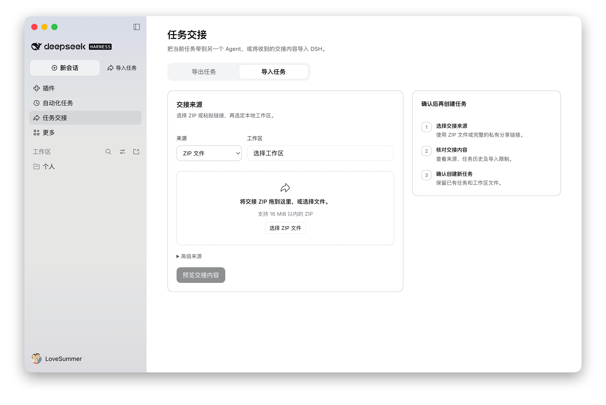

# DSH verification receipt

## 0.5.1 UI and distribution update

Validated on 2026-11-19 with Node 24.14.1 and the released DSH rc.5 SDK:

- `npm run check` passed typecheck, **86 tests / 8 files**, and Host/Client builds.
- The same 86 tests and Host typecheck passed against the released rc.1 SDK,
  reusing the local npm cache in offline mode.
- Eight new interaction cases cover case-insensitive title/path search, Chinese
  Windows paths, clearing filters, no matches and preserving the selected export
  identity until another task is explicitly chosen. They also cover the combined
  editable dropdown, arrow/Enter selection, IME composition, Escape/Tab dismissal
  and outside-click cancellation. The controls are real version-matched SDK atoms.
- `make cross VERSION=v0.5.1` built all five platform cores; the package checker
  passed the 42-file package, native Client wrapper and bridge protocol probe.
- The visible import sources are ZIP upload and encrypted link. The existing
  host API path-input contract remains compatible.
- Installed and enabled **0.5.1** through Desktop **0.2.2-rc.5**'s official plugin
  installer; its installed-version card and the running Host were checked.
- Native Desktop acceptance imported two synthetic tasks through ZIP preview,
  workspace selection and explicit conversation-mode confirmation. Both received
  fresh identities, and opening one showed the synthetic history and idle composer.
- The installed search matched lowercase title input against the mixed-case task
  title, and a workspace path with surrounding spaces matched all 18 catalog
  entries. The final package uses one editable dropdown with native input, menu
  surface and icons. Native acceptance checked no-match feedback, the inline clear
  action, Escape/Tab cancellation, pointer selection and arrow/Enter selection.
- Selecting synthetic task A, then searching for B, retained A in the current
  selection notice. The final combined picker's downloaded ZIP still identified A
  and its two messages, and all seven payload checksums passed. Explicitly
  selecting B changed the overview and cleared A's previous download result.
  No real conversation was exported.
- The installed import view offers ZIP and link without the removed advanced
  host-file-path controls. Both acceptance tasks were reversibly archived after
  the checks; existing tasks were not changed.

The session adapters and handoff format are unchanged. The last completed
three-host continuation and native Desktop baseline is recorded below.

## 0.5.0 compatibility baseline

Validated 2026-11-19 for plugin/core **0.5.0**, against released DSH SDKs
**0.2.2-rc.1 and 0.2.2-rc.5** (session format 4), Cordis 4.1.0 and Node 24.14.1.
The rc.5 source reference is upstream `2e39e70496aa02986ca6a820c5d497e816b69d7e`.
Native CLI acceptance used **Codex 0.167.1** and **Claude Code 2.1.322**.

Automated tests use synthetic conversations, disposable homes and loopback model
APIs. The separately authorized manual acceptance installed the plugin in the
user's actual macOS DSH Desktop **0.2.2-rc.1**. It imported only synthetic tasks;
existing task contents were not read or rewritten. The three acceptance tasks
were archived through DSH's reversible archive action afterward.

## Automated checks

- `go test ./... -count=1 -race` and `go vet ./...` passed. Subsequent changes to
  native-client acceptance were checked with the integration package under
  `-race` and its targeted native-client cases.
- `make cross VERSION=v0.5.0` built all five packaged cores.
- `npm run check`: typecheck, **78 tests / 8 files**, and both Host/Client builds
  passed against rc.5. `npm run check:compat` passed the same 78 tests and Host
  typecheck against the actual released rc.1 SDK and version-matched controls.
- Tests use the selected SDK's real controls and SlotRegistry. The runner rejects
  supplemental UI packages whose name or version does not match that SDK.
- `npm run package` and `npm run check:package` passed for the final 0.5.0 tarball:
  42 files, both native entries, declarations, locale, icon, licenses and five
  matching transfer cores. It does not depend on the development SDK directory.
- CI repeats Go, plugin installation and DSH checks on Ubuntu/macOS/Windows,
  including both DSH SDK versions. Local execution was on macOS; no physical
  Windows Desktop acceptance is claimed.

## Transfer and continuation coverage

| Source → destination | Evidence |
| --- | --- |
| Codex → Codex | Built CLI share/import; actual Codex history discovery, completed local-model turn, second-process history read |
| Codex → Claude | Built CLI share/import; actual Claude sends imported history and receives a new local-model reply |
| Claude → Codex | Built CLI share/import; actual Codex completes a new turn and cold-reopens old/new history |
| Claude → Claude | Built CLI share/import; actual Claude sends imported history and receives a new reply |
| DSH → Codex | SDK-produced and actual plugin-exported ZIPs; actual Codex continuation and cold reopen |
| DSH → Claude | SDK-produced and actual plugin-exported ZIPs; actual Claude continuation and new reply |
| Codex → DSH | Real SDK persistence/controller/AgentLoop, two cold reopens and local continuation; actual Desktop ZIP preview/import/open |
| Claude → DSH | Real SDK persistence/controller/AgentLoop, two cold reopens and local continuation; actual Desktop ZIP preview/import/open |
| DSH → DSH | Reviewed passive native history plus explicit conversation fallback; SDK cold continuation and actual Desktop exported-ZIP import/open |

Native CLI acceptance runs with `AGENT_HANDOFF_NATIVE_TESTS=1` in the integration
package. `AGENT_HANDOFF_NATIVE_DSH_BUNDLE` optionally adds an explicitly supplied
synthetic plugin export. The fresh Desktop rc.1 export was independently checked
for source version, both Chinese messages and all seven payload checksums. Its
two targeted native-client checks passed under `-race` (5.802s and 3.676s).

Model requests contain imported conversation and paired historical tool evidence
where the fixture includes it. Imported tool execution stays zero. Codex makes
one local model request, completes the new turn and rereads old/new messages in
a second process without another model call. Claude's actual CLI output includes
the new local reply; a second cold Claude process after that turn is not claimed.
No paid model, real credential or cloud-sync acceptance is claimed.

## Installed native UI and Host

The generated tarball was first installed in an isolated Web profile, then the
final **0.5.0** package was installed and enabled using actual Desktop's official
third-party plugin UI. Its installed-version card showed 0.5.0. Desktop's bundled
Node 24.21.0 satisfies the package engine requirement.

Desktop acceptance verified:

- Separate **Export task / Import task** tabs with native themed controls, a
  source/settings area and a preview/summary area. Empty tasks cannot export.
- Codex, Claude and DSH ZIPs pass preview/checksum checks, bind to an explicitly
  selected workspace/mode, create fresh IDs and open with the original synthetic
  conversation and an idle composer. ZIP upload and host-path input both work.
- Ordinary DSH logs containing authority/runtime events require an explicit
  conversation import; the UI explains the omitted state before confirmation.
- The task-header Share action creates a ZIP that the native save dialog writes
  successfully. That fresh file then passed actual Codex and Claude continuation.

The isolated installed-profile Host/API check also verified unauthorized HTTP
401, safe native and explicit conversation imports, duplicate detection after
restart, concurrent confirmations returning one fresh ID, summaries and ZIP
downloads. The actual Desktop fetch carrier was inspected in the released
application software: it checks Origin, adds the owned Host cookie and forwards
request body/cancellation. Manual UI acceptance confirms that path works.

## Regression and support boundaries

Tests cover malformed/truncated/unknown/checksum/size failures, decoded secret
scan, explicit secret-snapshot confirmation, immutable previews, workspace/mode
binding, expiry, recovery IDs, dead/live writer locks, request/body/subprocess
cancellation and plugin unload. Lifecycle regressions cover the protected first
system head, missing tool results and model-only replacement summaries.

Support is verified for the two exact DSH preview versions above. Native
restoration accepts reviewed passive history only.
Conversation import preserves text/tool evidence and a private inert raw audit;
it does not restore credentials, permissions, source system prompts, plugins,
presets, queued work, full media or provider runtime state. Same-agent Codex
resume requires the receiver to configure the source provider ID independently.

Distribution uses the public `dsh-agent-handoff` npm package and a GitHub Release
`.tgz` with a SHA-256 checksum. The first npm publication, 0.5.0, was independently
downloaded by package name and matched the published tarball. The tagged release
workflow builds the five matching cores, checks and packs the plugin, then
publishes the tarball and checksum alongside CLI archives. Source builds remain
available. Workflow configuration/shell validation and runtime acceptance are
recorded separately; the publishing execution is visible in the repository's
Release workflow runs.
